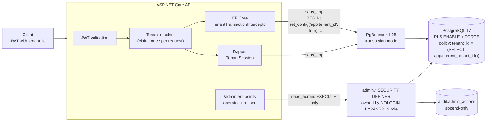
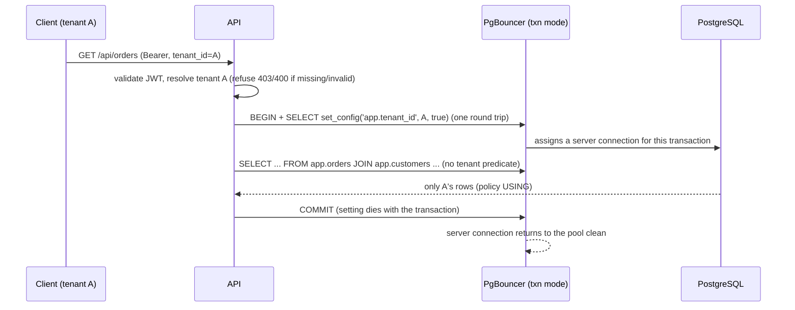

# saas-rls-starter

[](https://github.com/hekimcan206/saas-rls-starter/actions/workflows/ci.yml)
[](https://github.com/hekimcan206/saas-rls-starter/actions/workflows/codeql.yml)
[](LICENSE)


A multi-tenant SaaS skeleton in .NET 10 where **PostgreSQL enforces tenant isolation**, not `WHERE` clauses. Row-level
security with `FORCE`, a tenant set per *transaction* from a validated JWT claim, EF Core and Dapper integration, an
audited path for cross-tenant work, and tests that try to break all of it. The connection-pool pitfalls, including
PgBouncer in transaction mode, are reproduced for real and then fixed.

## The problem

In a shared-schema SaaS, a single forgotten `WHERE tenant_id = @tenant` shows one customer another customer's data.
RLS moves that predicate into the database, but RLS fails silently in several ways:

- it does not apply to superusers, to `BYPASSRLS` roles, or (without `FORCE`) to table owners, and a connection string
  pointing at the wrong role raises no error;
- a session-level `SET app.tenant_id` stays on a pooled connection and reaches the next request, or, behind
  PgBouncer in transaction mode, a *different client*;
- foreign keys, unique indexes and sequences answer questions about rows that RLS hides;
- views and SECURITY DEFINER functions run with their owner's rights;
- a policy written slightly wrong is either broken after the first transaction on a connection, or 6x slower on
  large tenants (measured below).

## The solution





## Why this design

- **Database-enforced isolation** ([ADR 0001](docs/adr/0001-row-level-security-with-force-and-a-non-owner-role.md)).
  Every table in schema `app` has `ENABLE` + `FORCE ROW LEVEL SECURITY` and a `USING` + `WITH CHECK` policy. The API
  connects as `saas_app`, which is not a superuser, has no BYPASSRLS, owns nothing and cannot `UPDATE tenant_id`.
  `RlsGuard` checks all of that **as the connected role** at startup and in `/health/ready`, and the API refuses to
  start as the owner or a superuser (tested, and asserted in CI against the compose stack).
- **Transaction-local tenant** ([ADR 0002](docs/adr/0002-transaction-local-tenant-variable.md)).
  `set_config(..., is_local => true)` as the first statement of every transaction: by `TenantSession` for Dapper, by
  an EF Core transaction interceptor for EF. A guard interceptor turns "EF query outside a transaction" (which would
  silently return zero rows) into an exception. Without a tenant you see zero rows and cannot write. A malformed tenant
  raises an error.
- **A policy that is correct and cheap** ([ADR 0003](docs/adr/0003-policy-expression-nullif-and-initplan.md)).
  `nullif(current_setting('app.tenant_id', true), '')::uuid` survives the `''` a setting reads back as after
  `SET LOCAL`. Wrapping the call as `(SELECT ...)` makes it an InitPlan: computed once per query, not once per row.
- **Audited cross-tenant role** ([ADR 0004](docs/adr/0004-audited-cross-tenant-admin-role.md)). `saas_admin` has no
  table privileges, only `EXECUTE` on four SECURITY DEFINER functions (pinned `search_path`) owned by a NOLOGIN
  BYPASSRLS role. Each function requires the human operator and a reason, and writes an append-only audit row in the
  same transaction.
- **PgBouncer transaction mode** ([ADR 0005](docs/adr/0005-pgbouncer-transaction-mode.md)) works because nothing is
  session-scoped. The compose stack runs the API through PgBouncer.
- **Side channels** ([ADR 0006](docs/adr/0006-closing-side-channels-rls-does-not-cover.md)): composite
  `(tenant_id, customer_id)` foreign keys, per-tenant unique keys, UUIDv7 ids and per-tenant counters instead of
  shared sequences, and coarse error mapping (another tenant's id is 404, never 403).

## Quick start

```bash
docker compose up --build
# ... demo-1 | {"checks":16,"passed":16,"failures":[]}
```

`docker compose up` starts PostgreSQL 17, PgBouncer 1.25 (transaction mode), a one-shot migrator and the API, then a
demo client that onboards two tenants through the audited admin path and checks isolation over HTTP. It then replays
the pool pitfalls against PostgreSQL and PgBouncer and prints the audit trail:

```text
== 3. Tenant A can't see B
  PASS  A lists only its 3 customers
  PASS  A GET of B's customer is 404
  PASS  order for B's customer looks exactly like a missing customer
  PASS  tenantId in the body is ignored
  PASS  X-Tenant-Id header spoofing is ignored in claim mode
  ...
== 4. Connection-pool pitfalls, for real
  PASS  BROKEN: session SET + No Reset On Close leaks A to the next request  (next request saw 4 customers)
  PASS  FIXED: Npgsql's reset on return (DISCARD ALL) clears it  (next request saw 0)
  PASS  BROKEN: PgBouncer transaction mode hands A's session SET to another client  (client B saw 4)
  PASS  FIXED: SET LOCAL through PgBouncer leaves nothing behind  (client B saw 0)
== 5. Cross-tenant work is audited
    #3 tenant.usage   by demo@example.test as saas_admin: "compose demo onboarding"
{"checks":16,"passed":16,"failures":[]}
```

Try it yourself (the API is on `127.0.0.1:58980`, Scalar UI at `/scalar`; `/dev/token` exists only in Development
and the compose demo):

```bash
TOKEN=$(curl -s localhost:58980/dev/token -H 'content-type: application/json' \
  -d '{"subject":"ops","roles":["platform_admin"]}' | jq -r .access_token)
TENANT=$(curl -s localhost:58980/admin/tenants -H "authorization: Bearer $TOKEN" \
  -H 'X-Admin-Reason: trying the quick start' -H 'content-type: application/json' -d '{"name":"Initech"}' | jq -r .id)
USER=$(curl -s localhost:58980/dev/token -H 'content-type: application/json' \
  -d "{\"subject\":\"milton\",\"tenantId\":\"$TENANT\"}" | jq -r .access_token)
curl -s localhost:58980/api/customers -H "authorization: Bearer $USER" -H 'content-type: application/json' \
  -d '{"name":"Milton","email":"milton@initech.example"}'
```

Local development: `docker compose up postgres` and `dotnet run --project src/SaasRls.Api` (Development settings
migrate on start and connect as `saas_app`). Tests: `dotnet test` (Docker required).

## Using it in your own code

```csharp
// Program.cs
builder.Services.AddTenancy(appDataSource, o => o.Source = TenantSource.Claim);
builder.Services.AddDbContext<MyDbContext>((sp, o) => o.UseNpgsql(appDataSource).UseTenantRls(sp));
app.UseAuthentication(); app.UseAuthorization(); app.UseTenantResolution();

// EF Core: the whole group runs in one tenant transaction
app.MapGroup("/api/customers").RequireTenant().WithTenantTransaction<MyDbContext>()
   .MapGet("/", (MyDbContext db) => db.Customers.ToListAsync());   // no tenant filter anywhere

// Dapper
await using var session = await tenantDb.BeginAsync(ct);           // BEGIN + set_config(..., true)
var rows = await session.QueryAsync<Order>("SELECT * FROM app.orders ORDER BY created_at DESC LIMIT 50");
await session.CommitAsync(ct);

// One round trip for a single read: SET LOCAL + query in one implicit transaction
var top = await tenantDb.QueryInImplicitTransactionAsync<Order>(tenant, "SELECT ...");
```

## Tests

**108 tests**: 46 unit/property and 62 integration tests against PostgreSQL 17 and PgBouncer 1.25 in Testcontainers,
all run in CI.

| Suite | What it proves |
|---|---|
| `TenantIsolationTests` | As `saas_app`, with no tenant predicate in the SQL: read, update, delete, insert with a foreign `tenant_id`, moving a row between tenants, composite FKs indistinguishable from missing rows, joins, aggregates, the `security_invoker` view, an invoker function, `COPY TO` / `COPY FROM`, per-tenant counters, no-tenant and malformed-tenant fail-closed, error-oracle predicates, per-tenant uniqueness, cached generic plans, one-round-trip reads |
| `IsolationPropertyTests` (FsCheck) | Random data sets (2 to 5 tenants, random customers, orders and amounts), queried by every tenant concurrently: no cross-tenant row is ever returned, and every count and sum matches the tenant's own model (30 cases per run) |
| `RlsPitfallTests` | Each common defeat reproduced and shown to leak: definer view, `ENABLE` without `FORCE`, SECURITY DEFINER function (flagged by `RlsGuard`), plain FK, global unique index, shared sequence, policy without `nullif`, planner statistics (residual) |
| `ConnectionPoolPitfallTests` | Session `SET` leaking to the next request with `No Reset On Close`; Npgsql's reset observed as `DISCARD ALL` in the server log; `SET LOCAL` never leaking, including after rollback and errors; leaks left by other code detected |
| `PgBouncerTests` | Real PgBouncer, transaction mode: a session `SET` reaches a different client, outlives the client that set it, and Npgsql's reset does not help; `SET LOCAL` is safe; session mode resets on disconnect; 200 concurrent tenant sessions isolated next to a client that keeps planting another tenant |
| `ApiTests`, `DatabaseRoleTests` | 401/403/400 before handlers, spoofing ignored, 404 for other tenants' ids, audited admin flow end to end, API refusing to start as owner or superuser, append-only audit, 200 concurrent requests through PgBouncer |
| Unit | `TenantId` parsing (FsCheck), resolvers, middleware, interceptors, a static lint over the migrations (ENABLE + FORCE + policy everywhere, `security_invoker` views, pinned `search_path`) |

## Results (measured)

PostgreSQL 17.11 in Docker on a shared Windows laptop (i7-13620H), 500,000 rows per table, median of 3 runs.
Method, environment, host load and raw data: [docs/benchmarks.md](docs/benchmarks.md).

**RLS vs the same query without RLS** (explicit `WHERE tenant_id = $1`), shipped policy form:

| Layout | Query | no RLS p50 | RLS p50 | overhead |
|---|---|---:|---:|---:|
| 1 tenant | point lookup by id | 0.316 ms | 0.324 ms | +2.3% |
| 1 tenant | latest 50 orders | 0.351 ms | 0.355 ms | +1.1% |
| 1 tenant | count + sum (500,000 rows) | 33.041 ms | 32.666 ms | -1.1% |
| 1,000 tenants | point lookup by id | 0.339 ms | 0.348 ms | +2.8% |
| 1,000 tenants | latest 50 orders | 0.378 ms | 0.387 ms | +2.6% |
| 1,000 tenants | count + sum (500 rows) | 0.768 ms | 0.783 ms | +1.9% |

**How the policy is written matters more than RLS itself:**

| Policy | Query | RLS p50 | vs no RLS |
|---|---|---:|---:|
| `tenant_id = (SELECT app.current_tenant_id())` (shipped) | 1 tenant, count + sum | 32.666 ms | -1.1% |
| `tenant_id = app.current_tenant_id()` (bare call, evaluated per row) | 1 tenant, count + sum | 202.685 ms | +525% |
| `tenant_id::text = current_setting(...)` (cast defeats the index) | 1,000 tenants, latest 50 | 84.266 ms | +12,997% |

**Cost of setting the tenant per transaction** (latest 50 orders, 1,000 tenants):

| Shape | round trips | p50 |
|---|---:|---:|
| no RLS, autocommit | 1 | 0.477 ms |
| no RLS, explicit transaction | 2 | 0.746 ms |
| RLS, `TenantSession` (BEGIN + `set_config`, query, COMMIT) | 3 | 1.269 ms |
| RLS, `SET LOCAL` + query in one batch | 1 | 0.617 ms |

Setting the variable costs one round trip (+0.52 ms on loopback), not server time. Sent in the same batch as the
query, it costs 0.11 ms over an unsafe session-level setting.

## Limitations and next steps

- **Residual channel:** `pg_class.reltuples` / `pg_stat_user_tables` reveal total row counts across tenants (tested,
  accepted in the [threat model](docs/threat-model.md)). Column statistics are hidden by PostgreSQL.
- **Admin operator identity** is asserted by the API process. Next: per-operator database logins, or a signed
  operator assertion verified in SQL.
- `TenantSession` spends a round trip on `set_config`. The one-batch form avoids it for single reads; pipelining it
  with the first statement of multi-statement transactions is a next step.
- Not measured: throughput under concurrency, PgBouncer's own overhead, write paths, tables over 500,000 rows.
- Prepared statements behind PgBouncer (Npgsql auto-prepare plus PgBouncer `max_prepared_statements`) are not tested.
  Npgsql's default (no auto-prepare) is used.
- JWTs are HS256 with a shared key for the demo. Production should validate the identity provider's tokens (JWKS).
  `/dev/token` must never be enabled outside development.
- A superuser can disable RLS and the audit triggers. Tamper evidence against administrators is out of scope.
- Schema per tenant / database per tenant for very large tenants is not covered.

## Privacy note

All data is synthetic; no real personal or health data. The schema is shaped for KVKK (Turkey's personal data
protection law) and GDPR duties: tenant offboarding deletes a tenant's rows through cascading composite keys in one
audited call (`admin.purge_tenant`), and every cross-tenant read is recorded with operator and reason.

## License

[MIT](LICENSE)
